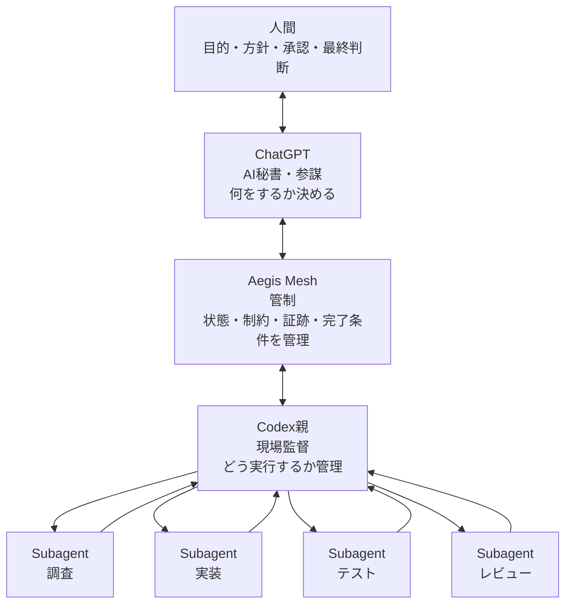
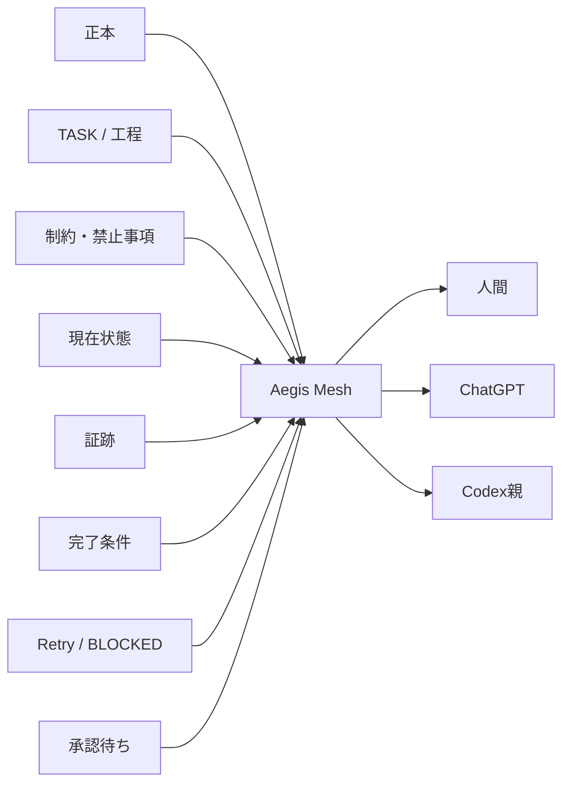
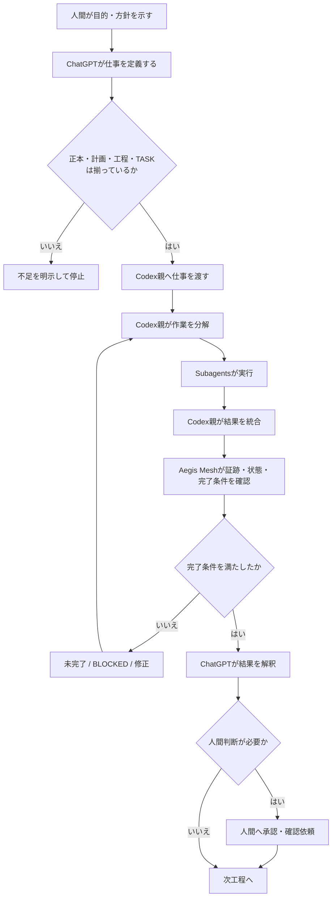
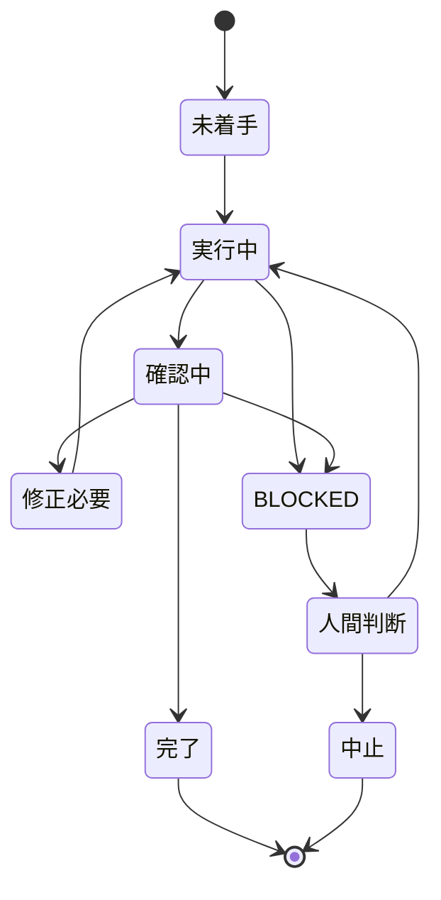
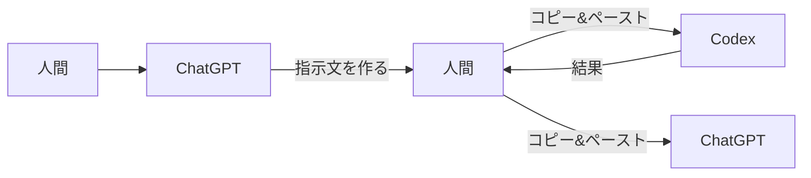
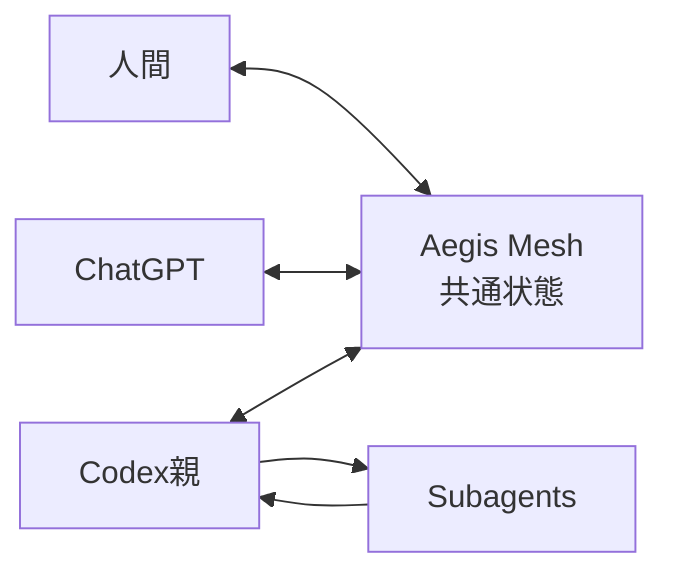
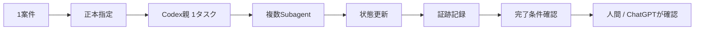
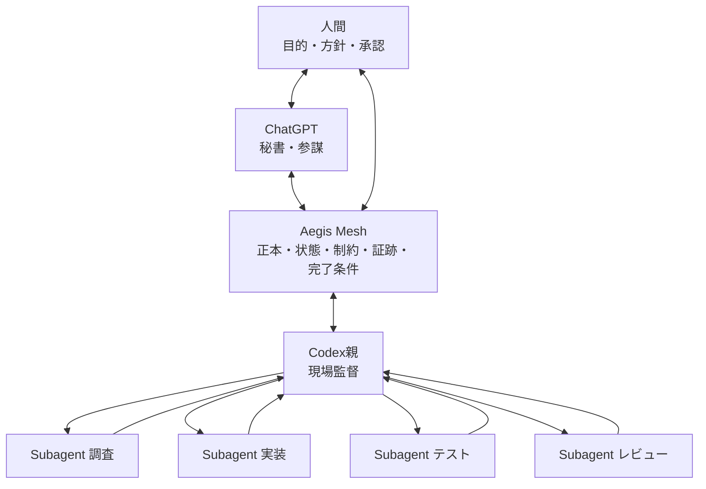

# 【Aegis Mesh】企画概要書

## 0. この文書の位置づけ

この文書は、Aegis Meshについて、これまでの議論をゼロから整理し直した企画概要書である。

過去に作成したAegis Mesh企画書・概要書・草案は、この文書の作成元として使用していない。

この文書では、次の4点を誰が読んでも分かる状態にする。

1. Aegis Meshは何のための仕組みか
2. 人間・ChatGPT・Codex親・Subagents・Aegis Meshの役割は何か
3. 仕事がどのように流れ、どこで止まり、何をもって完了とするか
4. 最初に何を作り、どこまでを実証するか

---

# 1. 一言でいうと何か

**Aegis Meshは、複数のAIを安全に働かせるための「管制システム」である。**

AIに仕事をさせること自体が目的ではない。

重要なのは、

- AIが勝手に前提を足さない
- 正本を無視して進まない
- 未確定事項を推測で埋めない
- 工程を飛ばさない
- 同じ失敗を繰り返さない
- 完了していないのに完了扱いしない
- どのAIが今何をしているか分かる
- 人間とChatGPTが同じ状態を見られる

という状態を作ることである。

---

# 2. なぜ必要なのか

AIを複数使うと、処理能力は上がる。

一方で、管理しなければ次の問題が起きる。

```text
人間
 ↓
ChatGPT
 ↓
Codex親
 ↓
Subagent A
Subagent B
Subagent C
 ↓
結果が戻る
```

一見すると効率的だが、実際には途中で次が起きる。

```text
正本を読んでいない
        ↓
AIが前提を推測する
        ↓
その推測を次のAIが事実として受け取る
        ↓
別のAIがその前提で実装する
        ↓
テストは通る
        ↓
しかし、そもそもの前提が間違っている
```

Aegis Meshが防ぎたいのは、単発のミスそのものよりも、

**間違った状態が、正しい前提として次のAIへ伝播すること**

である。

---

# 3. 全体構成

## 3.1 役割分担



Mermaid表示が使えない環境では、次の構造で読む。

```text
人間
  ↕
ChatGPT
  AI秘書・参謀
  「何をするか」を決める
  ↕
Aegis Mesh
  状態・制約・証跡・完了条件を管制する
  ↕
Codex親
  現場監督
  「どう実行するか」を管理する
  ↓
Subagents
  調査 / 実装 / テスト / レビュー
```

---

# 4. 誰が何をするのか

| 役割 | 主な責務 | やらないこと |
|---|---|---|
| 人間 | 目的、方針、仕様判断、承認、差戻し、最終確認 | 未確定事項をAI任せで確定しない |
| ChatGPT | 要件整理、優先順位、仕事の定義、結果の解釈、次の判断 | 未確認事項を事実扱いしない、勝手に実装しない |
| Aegis Mesh | 状態、制約、証跡、完了条件、Retry、BLOCKED、承認待ちの管理 | 自分で勝手に仕様判断しない |
| Codex親 | 作業分解、Subagent割当、並列実行、進捗管理、統合、完了条件確認 | 仕様を勝手に変えない |
| Subagents | 調査、実装、テスト、レビュー等の実作業 | 指示範囲外へ勝手に広げない |

---

# 5. Aegis Meshの本当の役割

Aegis Meshは「もう1人のAI」ではない。

Aegis Meshは、AI同士の間にある**管制層**である。

## 5.1 管制する対象



Aegis Meshが最低限管理するものは次のとおり。

- 正本は何か
- 今どの工程か
- 誰が担当しているか
- 何をしてよいか
- 何をしてはいけないか
- 何が完了条件か
- 何を変更したか
- 何を確認したか
- 何が未確認か
- 何回失敗したか
- BLOCKEDしているか
- 人間承認が必要か

---

# 6. 仕事の流れ

## 6.1 基本フロー



---

# 7. 「止まる」ことを仕様にする

Aegis Meshでは、進むことだけでなく、**正しく止まること**を重要機能とする。

次の場合は停止する。

- 正本がない
- 正本を確認できない
- 計画書がない
- 開発工程表がない
- 対象工程の実装指示書がない
- TASK_CURRENT.mdがない
- 文書間で矛盾している
- 未確定事項が残っている
- 指定外変更が必要になる
- 外部通信や権限変更が必要になる
- 同じ失敗を繰り返している
- 完了条件を満たしていない

## 7.1 状態遷移の考え方



---

# 8. 正本と実装文書

Aegis Mesh案件では、文書の役割を混ぜない。

## 8.1 最小構成

```text
【Aegis Mesh】企画概要書.md
        ↓
【Aegis Mesh】計画書.md
        ↓
クロスレビュー
        ↓
【Aegis Mesh】未確定事項確認書.md
        ↓
必要な修正・確定
        ↓
【Aegis Mesh】開発工程表.md
        ↓
TASK_CURRENT.md
        ↓
工程ごとの実装指示書
        ↓
実装
```

| 文書 | 役割 |
|---|---|
| 企画概要書 | 何を作るか、なぜ作るか、基本構造 |
| 計画書 | どの順序で作るか |
| 開発工程表 | 工程番号、目的、完了条件、確認観点、変更対象 |
| 実装指示書 | その工程で実際に何をするか |
| TASK_CURRENT.md | 今どこまで進んでいるか |

Aegis Mesh自身も、他案件を管制する前に、この文書構造に従う。

---

# 9. 正本の扱い

正本は、AIの記憶やチャット履歴ではない。

正本は、案件の目的・仕様・判断基準を固定する外部文書である。

## 9.1 正本を起点にする理由

```text
チャット記憶だけ
  ↓
忘れる / 圧縮される / 解釈が変わる
  ↓
前提がずれる

正本あり
  ↓
毎回同じ基準に戻れる
  ↓
人間・ChatGPT・Codexが同じ前提を確認できる
```

正本がない場合は、ないことを明示する。

存在しない正本を、AIが勝手に想像して作ったことにしてはいけない。

---

# 10. ChatGPTとCodexの関係

Aegis Meshの考え方では、ChatGPTとCodex親を同じ役割にしない。

## ChatGPT

**何をするかを決める。**

- 目的を理解する
- 要件を整理する
- 優先順位をつける
- 仕事の塊を定義する
- 結果を読み解く
- 次に何をするか判断する

## Codex親

**どう実行するかを決める。**

- 作業を分解する
- Subagentへ割り振る
- 並列処理する
- 進捗を見る
- 結果を統合する
- 完了条件を確認する

## Aegis Mesh

**その両方が正しい状態で動いているかを監視する。**

---

# 11. 現状と目標

## 11.1 現状



現状では、人間がAI間の通信係になっている。

さらに、状態管理がチャット・ローカル・Drive・Git等へ分散すると、どこが最新か分からなくなる。

## 11.2 目標



人間、ChatGPT、Codex親が、同じ管制状態を見る。

人間は全AIの画面を見回らない。

ChatGPTもCodexの報告だけを鵜呑みにせず、Aegis Meshの状態と証跡を見る。

---

# 12. 管制画面

Aegis Meshの画面は、単なるTODO一覧ではない。

「AI組織が今どうなっているか」を見るための画面である。

## 12.1 最低限必要な表示

```text
┌─────────────────────────────────────────────┐
│ Aegis Mesh                                  │
│ 案件：営業AIメモ                            │
│ 現在工程：IS-07                             │
│ 全体状態：実行中                            │
├─────────────────────────────────────────────┤
│ Codex親   現場監督   実行中                 │
│                                             │
│ Subagent A  調査      完了                  │
│ Subagent B  実装      実行中                │
│ Subagent C  テスト    待機                  │
│ Subagent D  レビュー  待機                  │
├─────────────────────────────────────────────┤
│ Retry        1 / 2                          │
│ BLOCKED      0                              │
│ 未解決事項   2                              │
│ 人間確認待ち 1                              │
│ 最終更新     18:32                          │
└─────────────────────────────────────────────┘
```

最低限、次を確認できるようにする。

- 案件
- 現在工程
- 全体状態
- Codex親の状態
- Subagent一覧
- 各Subagentの役割
- 今やっていること
- 実行中 / 完了 / 待機 / BLOCKED
- 結果概要
- テスト結果
- Retry回数
- 未解決事項
- 人間確認待ち
- 最終更新

---

# 13. ChatGPTも同じ状態を見る

Aegis Meshの画面は、人間だけのためではない。

ChatGPTも同じ管制データを読める必要がある。

```text
人間
  ↓
画面を見る

ChatGPT
  ↓
同じ状態データを読む

Codex親
  ↓
同じ状態を更新する
```

これによりChatGPTは、

- テスト未実施
- BLOCKEDが残っている
- Subagentの一部だけ未完了
- Retryが上限に近い
- 正本と作業内容がずれている

といったことを、Codex親の自己申告だけに頼らず判断できる。

---

# 14. GitHubの位置づけ

GitHubはAegis Meshそのものではない。

GitHub `xxxinakenxxx-hash/Aegis-Mesh` を、正本・計画・TASK・証跡・変更履歴を保持する基盤として正式採用する。

- Markdown正本
- TASK
- Issue
- branch
- commit
- PR
- test結果
- 変更履歴

ただし、GitHubだけでは次は決まらない。

- 誰がCodexを起動するか
- いつ起動するか
- どのタスクを割り振るか
- どこで止めるか
- 何をもって完了とするか
- ChatGPTへどう返すか

したがって、

```text
GitHub
= 正本・計画・TASK・証跡・変更履歴を保持する基盤

Aegis Mesh
= 状態遷移と実行条件を管制する仕組み
```

として分ける。

---

# 15. 実装技術はまだ正本で固定しない

Aegis Meshを何で実装するかは、企画そのものとは分離する。

候補として考えられるものには、

- Node.js / TypeScript
- Vercel
- GAS
- GitHub
- その他の実行基盤

がある。

しかし、先に決めるべきなのは技術ではない。

先に固定するのは次である。

```text
何を管理するか
何を正本とするか
誰が何をするか
どこで止めるか
何をもって完了とするか
何を証跡として残すか
誰が承認するか
```

技術選定は、この要件を満たす方式を後で選ぶ。

---

# 16. 最初の実証

最初から全部を作らない。

最初の実証では、1案件だけを対象にする。

## 16.1 最小実証範囲



必要機能は次のとおり。

1. 1案件を登録できる
2. 正本を指定できる
3. 現在工程を持てる
4. Codex親のタスクを持てる
5. Subagentを複数持てる
6. 状態を記録できる
7. Retry回数を記録できる
8. BLOCKEDを記録できる
9. 完了条件を記録できる
10. 証跡を残せる
11. 人間確認待ちを記録できる
12. ChatGPTが同じ状態を読める

---

# 17. 最初の評価基準

Aegis Meshの最初の実証で確認するのは、機能数ではない。

次ができるかで評価する。

| 評価項目 | 確認内容 |
|---|---|
| 正本統制 | 正本を読まずに進まないか |
| 未確定停止 | 不明点を推測で埋めず止まれるか |
| 工程統制 | 前工程を飛ばさないか |
| 状態可視化 | Codex親とSubagentの現在地が見えるか |
| Retry統制 | 同じ失敗を繰り返さないか |
| 完了判定 | 完了条件未達で完了扱いしないか |
| 証跡 | 何をしたか後から確認できるか |
| 共通状態 | 人間とChatGPTが同じ状態を見られるか |

---

# 18. 初期段階でやらないこと

最初から次まではやらない。

- AIを完全自律化する
- 人間を完全に外す
- ChatGPTとCodexを完全自動接続する
- 複数AIサービスをすべて統合する
- すべての仕事をAegis Meshから直接実行する
- 複雑な権限管理を完成させる
- AIの判断を無条件に信用する

---

# 19. Aegis Meshが防ぐ事故

## 事故1：正本を読んでいない

```text
正本未確認
  ↓
停止
  ↓
「正本未確認」と表示
```

## 事故2：未確定事項を勝手に補完

```text
仕様不明
  ↓
推測しない
  ↓
BLOCKED
  ↓
人間判断
```

## 事故3：実装済み＝完了と誤認

```text
実装済み
 ≠
テスト済み
 ≠
人間確認済み
 ≠
完了
```

## 事故4：同じ失敗を繰り返す

```text
失敗
 ↓
Retry 1
 ↓
同じ失敗
 ↓
Retry上限
 ↓
BLOCKED
```

---

# 20. 最終像



最終的に目指すのは、

**人間がすべてのAIを直接監視しなくても、ChatGPTが秘書・参謀として案件全体を把握し、Codex親が現場監督として実行を管理し、Aegis Meshがその間の正本・状態・制約・証跡・完了条件を共通事実として保持する状態**

である。

---

# 21. 結論

Aegis Meshの本質は、AIをたくさん動かすことではない。

**AIが、正しい前提・正しい範囲・正しい工程・正しい完了条件で仕事をしているかを、人間とChatGPTが同じ事実を見ながら管制できるようにすること**である。

Aegis Meshが成功した状態は、

```text
AIが増えた
```

ではない。

```text
AIが増えても、人間が混乱しない
AIが間違っても、間違いが次工程へ伝播しない
AIが止まるべきところで止まる
人間が必要な判断だけを受け取れる
```

状態である。