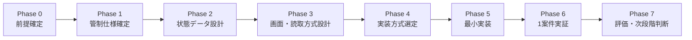
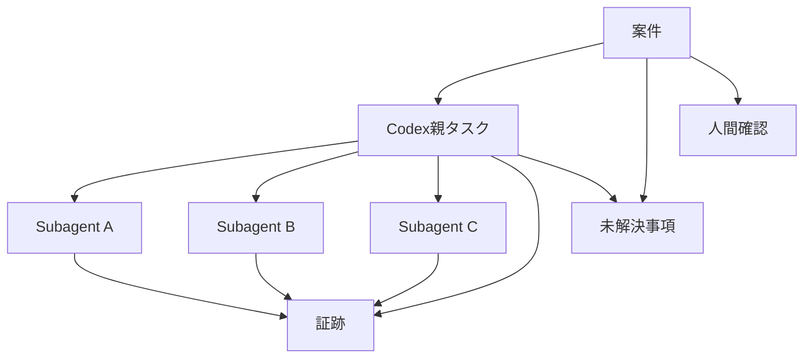
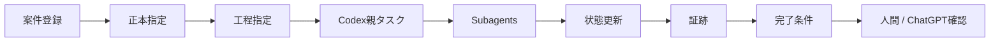
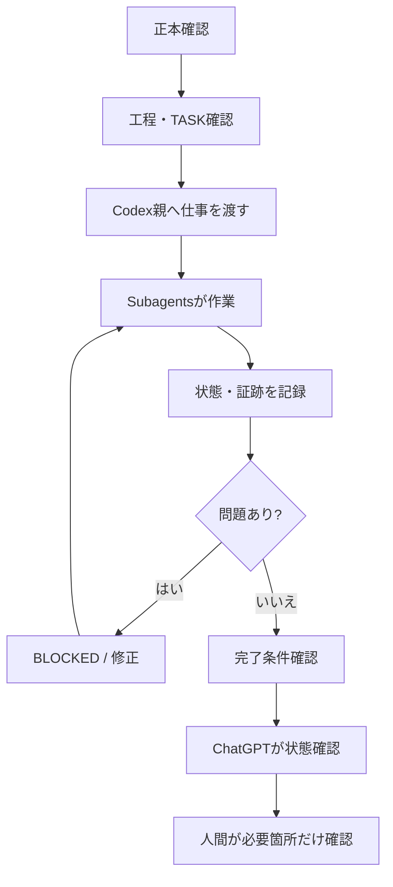
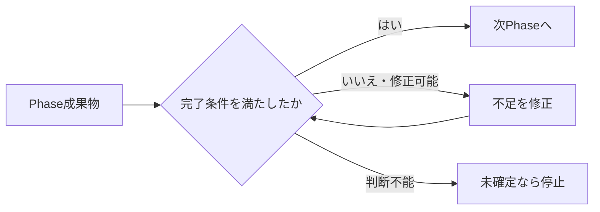

# 【Aegis Mesh】計画書

## 0. この文書の位置づけ

本書は、`【Aegis Mesh】企画概要書.md` をもとに、Aegis Meshをどの順序で具体化し、最初の実証まで進めるかを定める計画書である。

本書では、実装技術を先に固定しない。

企画概要書で定義した以下を実現するために、

- 正本を起点にする
- 未確定事項を推測で埋めない
- 工程を飛ばさない
- 同じ失敗を繰り返さない
- 完了していないものを完了扱いしない
- Codex親とSubagentsの状態を見えるようにする
- 人間とChatGPTが同じ状態を見られるようにする

必要な設計、実証、実装、確認を段階的に進める。

---

# 1. 計画の目的

Aegis Meshの最初の目標は、巨大な自動化基盤を完成させることではない。

**1案件を対象に、正本・工程・Codex親・Subagents・状態・証跡・完了条件・BLOCKEDを一つの管制状態として管理し、人間とChatGPTが同じ状態を確認できる最小実証を成立させること**を目的とする。

---

# 2. 全体計画



各Phaseは、前Phaseの成果物と確認がそろってから進む。

---

# 3. Phase 0：前提確定

## 3.1 目的

実装へ進む前に、Aegis Mesh自身の正本・計画・工程・TASKの管理方法を確定する。

## 3.2 確定するもの

- 正本：`【Aegis Mesh】企画概要書.md`
- 計画書：本書
- 開発工程表
- `TASK_CURRENT.md`
- 工程ごとの実装指示書
- 未確定事項一覧
- 前工程の完了確認方法

## 3.3 このPhaseで決めないもの

- Node.js / TypeScriptで作るか
- Vercelを使うか
- GASを使うか
- GitHubをどこまで使うか
- ChatGPTとCodexを完全自動接続するか

これらは後工程で判断する。

## 3.4 完了条件

- 正本が明示されている
- 計画書がある
- 開発工程表がある
- `TASK_CURRENT.md` がある
- 最初の実装工程の実装指示書がある
- 未確定事項が明示されている

---

# 4. Phase 1：管制仕様確定

## 4.1 目的

Aegis Meshが「何を管理し、どこで止め、何をもって完了とするか」を固定する。

## 4.2 管制対象

最低限、次を管理対象とする。

```text
案件
├─ 正本
├─ 現在工程
├─ 担当
├─ 許可事項
├─ 禁止事項
├─ 完了条件
├─ 状態
├─ Retry
├─ BLOCKED
├─ 証跡
├─ 未解決事項
└─ 人間確認待ち
```

## 4.3 状態定義

初期実証では、最低限次の状態を扱う。

- 未着手
- 実行中
- 確認中
- 修正必要
- 完了
- BLOCKED
- 人間判断
- 中止

## 4.4 停止条件

少なくとも次の場合は進めない。

- 正本がない
- 正本を確認できない
- 計画書がない
- 開発工程表がない
- 対象工程の実装指示書がない
- `TASK_CURRENT.md` がない
- 文書間に矛盾がある
- 未確定事項が残っている
- 指定外変更が必要
- 外部通信・権限変更等が必要
- Retry上限に達した
- 完了条件を満たしていない

## 4.5 完了条件

- 管制対象項目が一覧化されている
- 状態一覧が確定している
- 状態遷移条件が確定している
- 停止条件が確定している
- 完了判定条件が確定している
- 人間判断へ戻す条件が確定している

---

# 5. Phase 2：状態データ設計

## 5.1 目的

Aegis MeshがAIの記憶ではなく、外部状態として案件の現在地を保持できるようにする。

## 5.2 最低限保持するデータ

### 案件

- project_id
- 案件名
- 正本
- 現在工程
- 全体状態
- 未確定事項
- 最終更新

### Codex親タスク

- task_id
- 目的
- 作業範囲
- 許可事項
- 禁止事項
- 完了条件
- 状態
- Retry回数
- BLOCKED理由

### Subagent

- agent_id
- 役割
- 担当作業
- 状態
- 結果概要
- テスト結果
- 変更対象
- 未解決事項

### 証跡

- 何を変更したか
- 何を確認したか
- 何を実行したか
- 何を実行していないか
- エラー
- Retry履歴
- 人間確認結果

## 5.3 データ関係



## 5.4 完了条件

- 必要データ項目が定義されている
- 各状態をデータとして表せる
- Codex親とSubagentsの関係を表せる
- 証跡を後から追える
- 未解決事項を保持できる
- 人間確認待ちを保持できる

---

# 6. Phase 3：画面・ChatGPT読取方式設計

## 6.1 目的

人間とChatGPTが同じ管制状態を確認できる構造を決める。

## 6.2 人間向け画面

最低限、次を一覧で確認できるようにする。

- 案件名
- 現在工程
- 全体状態
- Codex親の状態
- Subagent一覧
- 各Subagentの役割
- 現在作業
- 実行中 / 完了 / 待機 / BLOCKED
- 結果概要
- テスト結果
- Retry回数
- 未解決事項
- 人間確認待ち
- 最終更新

## 6.3 ChatGPT向け読取

ChatGPTが、画面とは別に同じ状態データを読める方法を決める。

このPhaseでは、具体方式を先に固定せず、少なくとも次を満たすことを条件とする。

- 人間向け画面と同じ状態である
- Codex親の自己申告だけに依存しない
- Subagent状態まで追える
- 完了条件未達を判定できる
- BLOCKEDを判定できる
- 未解決事項を判定できる

## 6.4 完了条件

- 管制画面の情報構成が決まっている
- 人間が見る項目が決まっている
- ChatGPTが読む項目が決まっている
- 両者が同じ状態データを参照する構造になっている

---

# 7. Phase 4：実装方式選定

## 7.1 目的

ここまで確定した要件を満たす実装方式を選ぶ。

## 7.2 比較対象

企画概要書で候補に挙げたものを比較対象とする。

- Node.js / TypeScript
- Vercel
- GAS
- GitHub
- その他の実行基盤

## 7.3 比較観点

- 状態データを保持できるか
- APIまたは機械読取が可能か
- 人間向け画面を作れるか
- Codex親・Subagentsの状態を取り込めるか
- 将来の自動接続へ拡張できるか
- BLOCKEDやRetryを管理できるか
- 証跡を残せるか
- 運用負荷が過大でないか

## 7.4 GitHubの扱い

GitHubを使う場合も、Aegis Mesh本体と混同しない。

GitHubは、

- 正本
- TASK
- Issue
- branch
- commit
- PR
- test結果
- 変更履歴

の保持基盤候補として評価する。

## 7.5 完了条件

- 実装方式が比較されている
- 採用理由が明示されている
- 採用しない方式の理由も明示されている
- 最小実証に必要な構成だけが選ばれている
- 未確定事項が残る場合は、未確定として明記されている

---

# 8. Phase 5：最小実装

## 8.1 目的

1案件を管制できる最小機能を実装する。

## 8.2 最小実装範囲



実装対象は次に限定する。

1. 1案件を登録できる
2. 正本を指定できる
3. 現在工程を保持できる
4. Codex親タスクを1件以上保持できる
5. Subagentを複数保持できる
6. 状態を更新できる
7. Retry回数を記録できる
8. BLOCKED理由を記録できる
9. 完了条件を記録できる
10. 証跡を残せる
11. 人間確認待ちを記録できる
12. 人間が一覧で確認できる
13. ChatGPTが同じ状態を読める

## 8.3 このPhaseで作らないもの

- 完全自律実行
- ChatGPTとCodexの完全自動接続
- 複数AIサービスの全面統合
- 高度な権限管理
- 全案件対応
- 巨大な自動オーケストレーション

## 8.4 完了条件

- 最小実装範囲が動作する
- 状態データを保存・更新できる
- 人間向け表示ができる
- ChatGPTが同じ状態を読める
- BLOCKEDを表現できる
- 完了条件未達を完了扱いしない

---

# 9. Phase 6：1案件実証

## 9.1 目的

実際の1案件を使い、Aegis Meshが管制として機能するか確認する。

## 9.2 実証する流れ



## 9.3 評価項目

- 正本を読まずに進まなかったか
- 未確定事項で止まれたか
- 工程を飛ばさなかったか
- Codex親とSubagentsの現在地が見えたか
- 同じ失敗を繰り返さなかったか
- 完了条件未達で完了扱いしなかったか
- 証跡を後から確認できたか
- 人間が各AI画面を見回らずに済んだか
- ChatGPTが同じ状態から判断できたか

## 9.4 完了条件

- 1案件を開始から確認まで追跡できた
- BLOCKEDまたは停止条件を必要時に機能させられた
- 完了条件に基づいて完了判定できた
- 人間とChatGPTが同じ状態を確認できた
- 実証結果を記録できた

---

# 10. Phase 7：評価・次段階判断

## 10.1 目的

最小実証の結果から、次に何を拡張するか判断する。

## 10.2 判断対象

実証後、必要性が確認されたものだけを次段階候補とする。

- 複数案件対応
- ChatGPTとCodexの受け渡し自動化
- Codex状態の自動取得
- Subagent状態の自動取得
- GitHub連携強化
- 承認フロー自動化
- 複数AI製品対応
- 権限・認証の強化

## 10.3 完了条件

- 実証結果が整理されている
- 成功した点と失敗した点が分かれている
- 次に必要な機能が実証結果から選ばれている
- 不要な拡張を先に作らない判断ができている

---

# 11. 文書作成順

Aegis Mesh自身の開発は、次の文書順で進める。

```text
【Aegis Mesh】企画概要書.md
        ↓
【Aegis Mesh】計画書.md
        ↓
【Aegis Mesh】開発工程表.md
        ↓
TASK_CURRENT.md
        ↓
工程ごとの実装指示書
        ↓
実装
```

現在、本書までを作成対象とする。

次に作るべき文書は、**`【Aegis Mesh】開発工程表.md`** である。

---

# 12. 判断ゲート

各Phaseの間には判断ゲートを置く。



次Phaseへ進む条件は、前Phaseの成果物があることではなく、**前Phaseの完了条件を満たしていること**とする。

---

# 13. この計画で固定しないもの

現時点で、次はまだ確定しない。

- 実装言語
- ホスティング先
- GitHubを正本基盤にするか
- 状態データの保存先
- ChatGPTの状態読取方式
- Codex親から状態を取得する具体方式
- Subagent状態を取得する具体方式
- 完全自動受け渡しの方法

これらは、必要なPhaseで比較・検証して決める。

未確定のまま実装に必要になった場合は、推測で埋めず停止する。

---

# 14. 最終到達点

この計画の最終到達点は、次の状態である。

```text
人間
  ↕
ChatGPT
  秘書・参謀
  ↕
Aegis Mesh
  正本・状態・制約・証跡・完了条件
  ↕
Codex親
  現場監督
  ↓
Subagents
  実働
```

そして、

- AIが増えても人間が混乱しない
- AIが間違っても次工程へ誤前提を流さない
- 止まるべきところで止まる
- 完了条件未達を完了扱いしない
- 人間は必要な判断だけを受け取る
- ChatGPTは同じ管制状態を見て次の判断ができる

状態を最初の実証で確認する。

---

# 15. 結論

Aegis Meshは、いきなり完成形を作るのではなく、

**前提確定 → 管制仕様 → 状態データ → 画面・読取方式 → 実装方式選定 → 最小実装 → 1案件実証 → 評価**

の順で進める。

先に技術を決めるのではなく、まず「何を管制するのか」「どこで止めるのか」「何をもって完了とするのか」を固定する。

最初の成功条件は、AIの自動化率ではない。

**1案件について、人間とChatGPTが同じ状態を見ながら、Codex親とSubagentsの作業を安全に完了まで管制できること**である。