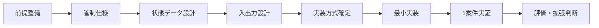

# 【Aegis Mesh】計画書

## 0. 文書の位置づけ

本書は、GitHubリポジトリ `xxxinakenxxx-hash/Aegis-Mesh` に保存された正本 `docs/正本/【Aegis Mesh】企画概要書.md` を起点に、Aegis Meshを最小実証まで進めるための開発計画を定める。

個別工程の具体的な実装内容は、開発工程表と工程別実装指示書で定義する。

---

# 1. 計画の目的

最初の到達点は、1案件について次を成立させることである。

- 正本を明示できる
- 現在工程を保持できる
- Codex親とSubagentsの状態を追える
- 許可事項・禁止事項・完了条件を保持できる
- RetryとBLOCKEDを管理できる
- 証跡を残せる
- 人間とChatGPTが同じ管制状態を確認できる
- 未確定事項や条件未達時に勝手に先へ進まない

---

# 2. 開発の基本方針



各Phaseは、前段階の完了条件を満たしてから次へ進む。

---

# 3. Phase 0：前提整備

## 現在確認できているもの

- 正本：`docs/正本/【Aegis Mesh】企画概要書.md`
- 計画書：本書
- 共通ルール：`docs/ルールブック.md`
- 正本・計画・TASK・証跡・変更履歴の基盤：GitHub `xxxinakenxxx-hash/Aegis-Mesh`

GitHubそのものをAegis Mesh本体とは定義しない。

## 文書整備順

```text
企画概要書
  ↓
計画書
  ↓
クロスレビュー
  ↓
未確定事項確認書
  ↓
必要な修正・確定
  ↓
開発工程表
  ↓
TASK_CURRENT.md
  ↓
対象工程の実装指示書
  ↓
実装
```

## クロスレビュー方針

- 通常レビュー：GPTで実施
- 重要・複雑・影響範囲が大きいレビュー：GPTとClaudeの両方で実施
- 両者の指摘が一致しない場合：AIで勝手に統合せず、人間判断へ戻す

重たいレビューには、少なくとも次を含む。

- 正本の基本構造変更
- 権限・認証・セキュリティ方針変更
- 自動操作の許可範囲変更
- 基幹データ構造・状態遷移変更
- 複数文書にまたがる矛盾解消
- Phase移行時の重要判定

## Phase 0完了条件

- 正本・計画書・クロスレビュー・未確定事項確認が完了している
- 必要な修正が反映されている
- 開発工程表・TASK_CURRENT.md・対象工程実装指示書がそろっている
- 実装開始を妨げる未確定事項がない

---

# 4. 自動操作の許可モデル

工程またはタスク単位で次を定義する。

```text
scope
allowed_actions
forbidden_actions
side_effect_policy
approval_required_if
```

操作は次の3区分で扱う。

| 区分 | 扱い |
|---|---|
| 事前許可済み | 許可範囲内で自動実行 |
| 条件付き許可 | 条件を満たす場合のみ自動実行 |
| 範囲外 / 禁止 | 停止して人間判断 |

人間の明示承認は、工程開始時の許可範囲設定でも成立する。許可範囲内では個別再承認を要求しない。

## Git操作

対象repository・branch・工程・変更範囲が明示されている場合、参照、作業branch作成、対象ファイル作成・更新、commit、通常push、PR作成を自動実行可とする。

mergeは、対象工程で許可され、必須チェック合格、BLOCKEDなし、未解決事項が完了条件を妨げておらず、禁止事項抵触なしの場合のみ条件付き自動とする。

履歴破壊につながる操作、repositoryやbranchの削除、指定外repository・branch・ファイル変更は標準禁止とする。

## デプロイ

- Codex：デプロイ不可
- Claude Code：対象工程で許可され、必須テスト合格、変更範囲内、BLOCKEDなし、禁止事項抵触なしの場合のみ条件付き自動デプロイ可

## その他の外部作用

| 操作 | 方針 |
|---|---|
| 承認済み外部通信先 | 条件付き自動 |
| 新規外部通信先 | 人間承認 |
| 外部API追加 | 人間承認 |
| パッケージ追加 | 人間承認 |
| 認証・権限変更 | 人間承認 |
| DB / スキーマ変更 | 人間承認 |
| 既存データ削除 | 原則禁止。専用の明示指示がある場合のみ実施 |

---

# 5. TASK_CURRENT.mdの責任分担

- 管理責任：ChatGPT
- 工程後の実績記入：Codex親 / 実装者AI
- TASK_CURRENTと実行状態の不整合監視：Aegis Mesh
- 仕様判断・承認・差戻し：人間

---

# 6. Phase 1：管制仕様の確定

## 決めるもの

- 管制対象
- 状態一覧
- 状態遷移条件
- 停止条件
- 完了判定条件
- Retry上限
- 同一失敗の判定方式
- 人間判断へ戻す条件
- 最終完了判定の責任分担

## 完了条件

- 上記が一意に定義されている
- 実装側が推測せず判断できる

---

# 7. Phase 2：状態データ設計

最低限、次を表現できる状態モデルを作る。

- Project
- Parent Task
- Subagent Task
- Evidence / Log
- Unresolved
- Human Approval
- Retry
- BLOCKED
- allowed_actions / forbidden_actions

## 完了条件

- Codex親とSubagentsの関係を表現できる
- 状態・Retry・BLOCKEDを表現できる
- 証跡を追跡できる
- 未解決事項と人間確認待ちを保持できる

---

# 8. Phase 3：人間・ChatGPT・Codexの入出力設計

## 人間

管制画面で、案件、工程、全体状態、Codex親、Subagents、テスト、Retry、BLOCKED、未解決事項、人間確認待ちを確認できる。

## ChatGPT

人間向け表示と同じ基礎状態を読み、完了条件未達、BLOCKED、未完了、Retry超過、正本不整合を判断できる。

## Codex親

自分とSubagentsの状態、結果、テスト、Retry、BLOCKED、証跡、未解決事項を更新できる。

---

# 9. Phase 4：実装方式の確定

ここで比較・決定する。

- 実装言語
- 状態データ保存方式
- 実行基盤
- 管制画面の実装方式
- ChatGPTの状態読取方式
- Codex親の状態更新方式
- Subagent状態取得方式
- 初期実証での自動接続範囲

実装方式は、それ以前に固定しない。

---

# 10. Phase 5：最小実装

1案件について次を実装する。

1. 正本指定
2. 現在工程
3. Codex親タスク
4. 複数Subagent
5. 状態更新
6. Retry
7. BLOCKED
8. 完了条件
9. 証跡
10. 未解決事項
11. 人間確認待ち
12. 人間向け表示
13. ChatGPTからの同一状態読取

---

# 11. Phase 6：1案件実証

実案件1件を使い、次を検証する。

- 正本未確認で進まない
- 未確定事項を推測で埋めない
- 工程を飛ばさない
- Codex親とSubagentsの現在地が見える
- Retry暴走を防ぐ
- BLOCKEDで止まる
- 完了条件未達を完了扱いしない
- 証跡を後から確認できる
- 人間が各AI画面を巡回せずに済む
- ChatGPTが同じ状態を見て判断できる

---

# 12. Phase 7：評価と次段階判断

実証結果から必要性が確認されたものだけを拡張する。

候補：

- 複数案件対応
- ChatGPTとCodexの受け渡し自動化
- Codex状態の自動取得
- Subagent状態の自動取得
- GitHub Issue / PR連携強化
- 承認フロー自動化
- 複数AI製品対応
- 権限・認証強化

---

# 13. 計画上の禁止事項

- 未確定事項を推測で確定しない
- 正本にない仕様を勝手に追加しない
- 工程をまとめて実装しない
- 前工程の確認前に次工程へ進まない
- 実装済みを利用可能・完了と同一視しない
- GitHubをAegis Mesh本体と扱わない
- 実装方式を要件より先に固定しない

---

# 14. 最終到達点

**1案件について、人間とChatGPTが同じ状態を見ながら、Codex親とSubagentsの作業を、正本・許可範囲・停止条件・完了条件・証跡に基づいて安全に完了まで管制できること**を最初の成功条件とする。
