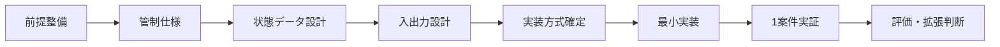
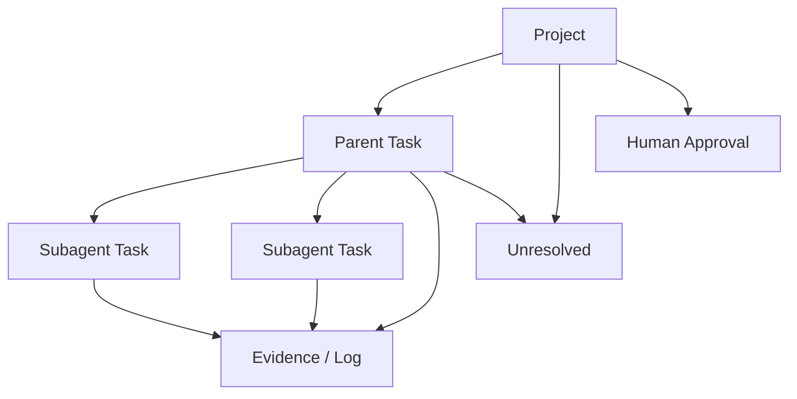
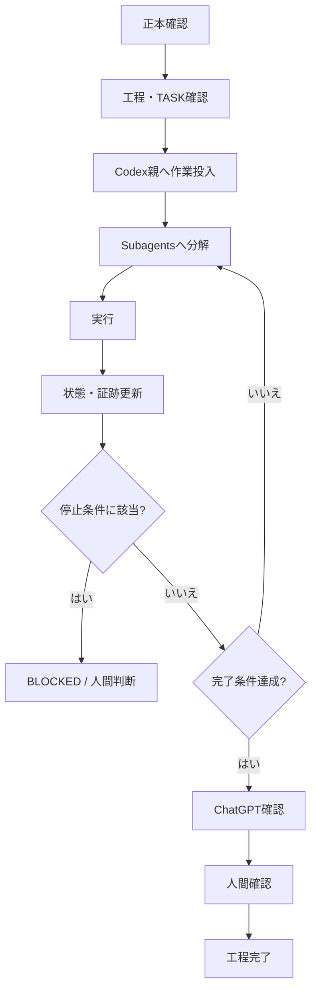

# 【Aegis Mesh】計画書

## 0. 文書の位置づけ

本書は、GitHubリポジトリ `xxxinakenxxx-hash/Aegis-Mesh` に保存された正本 `docs/正本/【Aegis Mesh】企画概要書.md` を起点に、Aegis Meshを最小実証まで進めるための開発計画を定める。

本書は「何をどの順番で決め、何を作り、どの条件を満たしたら次へ進むか」を定める。個別工程の具体的な実装内容は、開発工程表と工程別実装指示書で定義する。

---

# 1. 計画の目的

Aegis Meshの最初の到達点は、完全自律型の巨大なAI基盤を作ることではない。

最初に実証するのは、次の状態である。

- 1案件を対象にできる
- 正本を明示できる
- 現在工程を保持できる
- Codex親とSubagentsの状態を追える
- 許可事項・禁止事項・完了条件を保持できる
- Retry回数とBLOCKEDを管理できる
- 証跡を残せる
- 人間とChatGPTが同じ管制状態を確認できる
- 未確定事項や条件未達時に勝手に先へ進まない

---

# 2. 開発の基本方針

Aegis Meshは、次の順序で作る。



各段階は、前段階の完了条件を満たしてから次へ進む。

---

# 3. Phase 0：前提整備

## 目的

Aegis Mesh自身の開発を、正本とルールに従って開始できる状態にする。

## 現在確認できているもの

- 正本：`docs/正本/【Aegis Mesh】企画概要書.md`
- 計画書：本書
- 共通ルール：`docs/ルールブック.md`
- 正本保存先：GitHub `xxxinakenxxx-hash/Aegis-Mesh`

## このPhaseで作るもの

- `docs/計画/【Aegis Mesh】開発工程表.md`
- `TASK_CURRENT.md`
- 未確定事項一覧
- 最初の工程の実装指示書

## 完了条件

- 正本・計画書・開発工程表・TASK_CURRENT.md・対象工程実装指示書がそろっている
- 未確定事項が明示されている
- 前工程が存在する場合は、その完了状況が確認できる
- 実装開始前提が欠けていない

---

# 4. Phase 1：管制仕様の確定

## 目的

Aegis Meshが「何を管制し、どこで止め、何をもって完了とするか」を固定する。

## 決めるもの

### 管制対象

- 案件
- 正本
- 現在工程
- 担当AI
- 許可事項
- 禁止事項
- 入力
- 必要出力
- 完了条件
- 現在状態
- Retry回数
- BLOCKED理由
- 未解決事項
- 証跡
- 人間確認待ち

### 最小状態

- 未着手
- 実行中
- 確認中
- 修正必要
- BLOCKED
- 人間判断
- 完了
- 中止

### 停止条件

少なくとも次の場合は進めない。

- 正本がない、または確認できない
- 計画書・開発工程表・対象工程実装指示書・TASK_CURRENT.mdのいずれかがない
- 文書間に矛盾がある
- 未確定事項を解消しないと進めない
- 指定外変更が必要
- 外部通信・権限変更・データ構造変更等が必要
- Retry上限に達した
- 完了条件を満たしていない

## 完了条件

- 管制対象が一覧化されている
- 状態と状態遷移条件が決まっている
- 停止条件が決まっている
- 完了判定条件が決まっている
- 人間判断へ戻す条件が決まっている

---

# 5. Phase 2：状態データ設計

## 目的

案件の現在地をAIの記憶ではなく、外部状態として保持できるようにする。

## 最低限のデータ構造



### Project

- project_id
- project_name
- canonical_doc
- current_phase
- current_process
- status
- unresolved
- updated_at

### Parent Task

- task_id
- objective
- scope
- allowed_actions
- forbidden_actions
- required_outputs
- completion_tests
- status
- retry_count
- blocked_reason

### Subagent Task

- agent_id
- role
- assigned_work
- status
- result_summary
- test_result
- changed_targets
- unresolved

### Evidence / Log

- action
- result
- changed_target
- check_result
- error
- retry
- human_confirmation
- timestamp

## 完了条件

- 必要データ項目が定義されている
- Codex親とSubagentsの関係を表現できる
- 状態・Retry・BLOCKEDを表現できる
- 証跡を後から追える
- 未解決事項と人間確認待ちを保持できる

---

# 6. Phase 3：人間・ChatGPT・Codexの入出力設計

## 目的

同じ状態を、人間・ChatGPT・Codex親がそれぞれの役割で使えるようにする。

## 人間向け

最低限、次を一覧で確認できること。

- 案件名
- 現在工程
- 全体状態
- Codex親の状態
- Subagent一覧
- 各Subagentの役割
- 現在作業
- 実行中 / 完了 / 待機 / BLOCKED
- 結果概要
- テスト結果
- Retry回数
- 未解決事項
- 人間確認待ち
- 最終更新

## ChatGPT向け

人間向け画面と同じ基礎状態を読めること。

ChatGPTは少なくとも次を判断できる必要がある。

- テスト未実施
- 完了条件未達
- BLOCKED残存
- Subagent未完了
- Retry超過
- 正本との不整合
- 未解決事項残存

## Codex親向け

Codex親が少なくとも次を更新できること。

- 自分の状態
- Subagent状態
- 実行結果
- テスト結果
- Retry
- BLOCKED理由
- 証跡
- 未解決事項

## 完了条件

- 人間が見る情報が確定している
- ChatGPTが読む情報が確定している
- Codex親が更新する情報が確定している
- 3者が同じ基礎状態を共有する構造になっている

---

# 7. Phase 4：実装方式の確定

## 目的

Phase 1〜3で確定した要件を満たす実装方式を選定する。

## すでに確定しているもの

- GitHubリポジトリ：`xxxinakenxxx-hash/Aegis-Mesh`
- 正本文書の保存場所：`docs/正本/`
- 計画文書の保存場所：`docs/計画/`
- Git履歴で文書変更を追跡する

## このPhaseで比較・決定するもの

- 実装言語
- 状態データ保存方式
- 実行基盤
- 人間向け管制画面の実装方式
- ChatGPTから状態を読む方式
- Codex親から状態を書き込む方式
- Subagent状態をどう取得するか

## 比較観点

- 正本との連携
- 状態データの機械読取
- 更新の確実性
- 証跡性
- GitHubとの相性
- Codexからの利用可否
- ChatGPTからの利用可否
- UI実装容易性
- 将来の自動接続への拡張性
- 運用負荷

## 完了条件

- 採用方式が決まっている
- 採用理由が記録されている
- 不採用方式との比較が残っている
- 未確定事項が残る場合は未確定として明示されている

---

# 8. Phase 5：最小実装

## 目的

1案件を管制できる最小構成を実装する。

## 実装範囲

1. 案件を1件登録できる
2. 正本を指定できる
3. 現在工程を保持できる
4. Codex親タスクを保持できる
5. Subagentを複数保持できる
6. 状態を更新できる
7. Retry回数を管理できる
8. BLOCKED理由を管理できる
9. 完了条件を保持できる
10. 証跡を記録できる
11. 未解決事項を保持できる
12. 人間確認待ちを保持できる
13. 人間向け画面で確認できる
14. ChatGPTが同じ状態を読める

## このPhaseで作らないもの

- 完全自律実行
- ChatGPTとCodexの完全自動接続
- 複数AI製品の全面統合
- 高度な権限管理
- 複数案件の本格運用
- 巨大な自動オーケストレーション

## 完了条件

- 1案件の状態を保存・更新できる
- Codex親と複数Subagentを表現できる
- BLOCKED・Retry・未解決事項を表現できる
- 人間が状態を確認できる
- ChatGPTが同じ状態を読める
- 完了条件未達を完了扱いしない

---

# 9. Phase 6：1案件実証

## 目的

実案件1件を使い、Aegis Meshが管制システムとして機能するか確認する。

## 実証フロー



## 評価項目

- 正本未確認で進まなかったか
- 未確定事項を推測で埋めなかったか
- 工程を飛ばさなかったか
- Codex親とSubagentsの現在地が見えたか
- Retry暴走を防げたか
- BLOCKEDで止まれたか
- 完了条件未達を完了扱いしなかったか
- 証跡を後から確認できたか
- 人間が各AI画面を巡回せずに済んだか
- ChatGPTが同じ状態を見て判断できたか

## 完了条件

- 1案件を開始から完了判定まで追跡できる
- 停止条件が必要時に機能する
- 完了条件に基づいて完了判定できる
- 人間とChatGPTが同じ状態を確認できる
- 実証結果が記録される

---

# 10. Phase 7：評価と次段階判断

## 目的

最小実証の結果をもとに、次に拡張する範囲を決める。

## 拡張候補

- 複数案件対応
- ChatGPTとCodexの受け渡し自動化
- Codex状態の自動取得
- Subagent状態の自動取得
- GitHub Issue / PR等との連携強化
- 承認フロー自動化
- 複数AI製品対応
- 権限・認証強化

実証で必要性が確認されていない機能は、先に作らない。

---

# 11. 文書整備順

Aegis Meshの開発文書は次の順で整える。

```text
docs/正本/【Aegis Mesh】企画概要書.md
        ↓
docs/計画/【Aegis Mesh】計画書.md
        ↓
docs/計画/【Aegis Mesh】開発工程表.md
        ↓
TASK_CURRENT.md
        ↓
工程別実装指示書
        ↓
実装
```

この計画書の次に作成するのは、`docs/計画/【Aegis Mesh】開発工程表.md` とする。

---

# 12. 計画上の禁止事項

- 未確定事項を推測で確定しない
- 正本にない仕様を勝手に追加しない
- 工程をまとめて実装しない
- 前工程の確認前に次工程へ進まない
- 実装済みを利用可能・完了と同一視しない
- GitHubがAegis Meshそのものだと扱わない
- 実装方式を要件より先に固定しない

---

# 13. 最終到達点

```text
人間
  ↕
ChatGPT
  AI秘書・参謀
  ↕
Aegis Mesh
  正本・状態・制約・証跡・完了条件
  ↕
Codex親
  現場監督
  ↓
Subagents
  実働
```

最初の成功条件は、自動化率ではない。

**1案件について、人間とChatGPTが同じ状態を見ながら、Codex親とSubagentsの作業を、正本・停止条件・完了条件・証跡に基づいて安全に完了まで管制できること**を成功条件とする。
